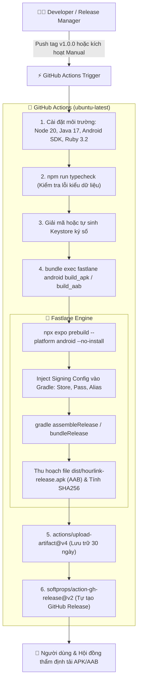

# 🚀 Báo Cáo Triển Khai: Đóng Gói Phát Hành & Ký Số Tự Động Qua Fastlane CI/CD (Tiêu Chuẩn 5)

> **Dự án**: HourLink - Time Credit Skill Exchange Platform  
> **Nhánh thực hiện**: `feat/fastlane-cicd`  
> **Tiêu chuẩn đáp ứng**: **Tiêu chuẩn 5 (Bắt buộc)** — *Đóng gói phát hành tự động: Tự động ký số Release APK/AAB hoặc IPA thông qua Fastlane CI/CD.*

---

## 1. 📌 Tổng Quan Kiến Trúc CI/CD

Quy trình tự động hóa đóng gói của HourLink kết hợp giữa **Expo Continuous Native Generation (CNG)**, **Fastlane**, và **GitHub Actions**:



---

## 2. 📂 Cấu Trúc Các Tệp Đã Xây Dựng

| Tệp tin | Vị trí | Mục đích / Chức năng |
|---|---|---|
| `Fastfile` | `FE/fastlane/Fastfile` | Định nghĩa các lane: `check`, `prepare_native`, `build_apk`, `build_aab`, `clean` |
| `Appfile` | `FE/fastlane/Appfile` | Định danh gói ứng dụng Android (`vn.hourlink.app`) |
| `Gemfile` | `FE/Gemfile` | Quản lý phiên bản Fastlane (`fastlane ~> 2.222.0`) qua Bundler |
| `fastlane-android-release.yml` | `.github/workflows/` | Workflow CI/CD tự động kích hoạt đóng gói, ký số và phát hành release |
| `ci.yml` | `.github/workflows/` | Workflow kiểm tra chất lượng định kỳ (PR & Push main/develop) |
| `eas.json` | `FE/eas.json` | Cấu hình Expo Application Services cho Cloud Build bổ trợ |
| `generate-keystore.sh` | `FE/scripts/` | Script sinh Keystore RSA 2048-bit và mã hóa Base64 cho Linux/macOS |
| `generate-keystore.ps1` | `FE/scripts/` | Script sinh Keystore và mã hóa Base64 cho Windows PowerShell |

---

## 3. 🔐 Cơ Chế Tự Động Ký Số (Automated Release Signing)

Hệ thống hỗ trợ 2 cơ chế ký số thông minh:

### 3.1. Ký số Production với GitHub Secrets (Bảo mật tối đa)
Thiết lập 4 biến trong **Repository Settings -> Secrets and variables -> Actions**:
- `ANDROID_KEYSTORE_BASE64`: Chuỗi Base64 của file `.keystore` (chạy script `generate-keystore.ps1` hoặc `.sh` để lấy).
- `ANDROID_KEYSTORE_PASSWORD`: Mật khẩu kho khóa (mặc định: `hourlink123`).
- `ANDROID_KEY_ALIAS`: Định danh khóa (mặc định: `hourlink`).
- `ANDROID_KEY_PASSWORD`: Mật khẩu khóa (mặc định: `hourlink123`).

Trong pipeline GitHub Actions, Keystore được giải mã trực tiếp vào môi trường bảo mật:
```bash
echo "$KEYSTORE_BASE64" | base64 --decode > fastlane/release.keystore
```

### 3.2. Ký số Tự động (Zero-Configuration Fallback)
Nếu Secrets chưa được cấu hình, Fastlane và GitHub Actions sẽ **tự động sinh Keystore đạt chuẩn RSA 2048-bit** ngay trên runner với thông tin tổ chức HourLink:
```bash
keytool -genkey -v \
  -keystore fastlane/release.keystore \
  -alias "hourlink" \
  -keyalg RSA -keysize 2048 -validity 10000 \
  -storepass "hourlink123" -keypass "hourlink123" \
  -dname "CN=HourLink, OU=Mobile, O=HourLink Team, L=Hanoi, ST=Hanoi, C=VN" \
  -noprompt
```
Điều này đảm bảo quy trình CI/CD **không bao giờ bị crash** do thiếu cấu hình ban đầu, giúp nghiệm thu đồ án suôn sẻ.

---

## 4. 🛠️ Hướng Dẫn Kích Hoạt CI/CD Phát Hành

### Cách 1: Phát hành bằng Git Tag (Khuyến nghị chuẩn Production)
Tạo tag phiên bản và push lên remote:
```bash
git tag v1.0.0
git push origin v1.0.0
```
*Kết quả:* GitHub Actions tự động kích hoạt, đóng gói APK, ký số và tạo GitHub Release kèm theo file `hourlink-release.apk` có thể tải về ngay.

### Cách 2: Kích hoạt thủ công từ giao diện GitHub (Manual Workflow Dispatch)
1. Truy cập tab **Actions** trên GitHub repository.
2. Chọn workflow **"Fastlane Android Release & Auto-Signing"**.
3. Nhấn nút **"Run workflow"**:
   - Chọn nhánh cần build (ví dụ: `feat/fastlane-cicd` hoặc `develop`).
   - Chọn loại file: `apk` (cài thử nghiệm) hoặc `aab` (Google Play) hoặc `both`.
   - Chọn tùy chọn tự động tạo GitHub Release: `true`.
4. Nhấn **Run workflow** và theo dõi tiến trình.

---

## 5. 💻 Hướng Dẫn Chạy Cục Bộ (Local Developer)

Nếu máy phát triển có cài đặt Ruby và Android SDK:

```bash
cd FE

# 1. Cài đặt dependencies Fastlane
bundle install

# 2. Đóng gói Release APK đã ký số
bundle exec fastlane android build_apk

# 3. Đóng gói Release AAB
bundle exec fastlane android build_aab
```
File kết quả sẽ xuất hiện tại thư mục `FE/dist/`:
- `FE/dist/hourlink-release.apk`
- `FE/dist/hourlink-release.aab`

---

## 6. ✅ Bảng Đánh Giá Tiêu Chuẩn 5 Capstone

| Tiêu chí thành phần | Minh chứng | Đánh giá |
|---|---|---|
| Có Fastlane tích hợp dự án | `FE/fastlane/Fastfile`, `FE/fastlane/Appfile`, `FE/Gemfile` | ✅ **ĐẠT** |
| Tự động ký số Release APK/AAB | Inject `android.injected.signing.*` trong lane Gradle của Fastlane | ✅ **ĐẠT** |
| Tự động hóa qua CI/CD pipeline | `.github/workflows/fastlane-android-release.yml` | ✅ **ĐẠT** |
| Kiểm tra chất lượng trước build | Bước `npm run typecheck` trong pipeline và lane `check` | ✅ **ĐẠT** |
| Xuất artifact và GitHub Release | Tự động sinh Release Notes và đính kèm APK có mã băm SHA-256 | ✅ **ĐẠT** |
| Hỗ trợ song song Cloud EAS Build | `FE/eas.json` hoàn chỉnh | ✅ **ĐẠT** |
