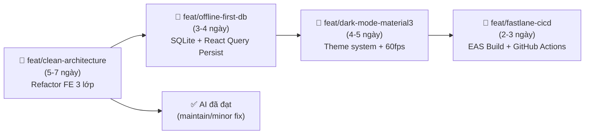

# 🎓 HourLink — Kiểm tra & Kế hoạch 5 Tiêu Chuẩn Capstone

> Phân tích dựa trên codebase thực tế tại `d:\FileStudy\JavaSpringBoot\hourlink`  
> Cập nhật: 2026-11-14

---

## 📊 Tổng quan — Kết quả kiểm tra

| # | Tiêu chuẩn | Trạng thái | Mức độ hoàn thành |
|---|---|---|---|
| 1 | Clean Architecture 3 lớp | ⚠️ **CHƯA ĐẠT** | ~50% |
| 2 | Tính năng AI thực sự | ✅ **ĐẠT** (nhưng cần nâng cấp) | ~75% |
| 3 | Offline-First + BaaS | ❌ **CHƯA ĐẠT** | ~15% |
| 4 | Material 3 / Dark Mode / 60fps | ⚠️ **CHƯA ĐẠT** | ~40% |
| 5 | Fastlane CI/CD Release | ❌ **CHƯA ĐẠT** | ~0% |

---

## 🔍 Chi tiết kiểm tra từng tiêu chuẩn

### Tiêu chuẩn 1 — Clean Architecture 3 lớp

**Phát hiện:**
- BE (Spring Boot) có cấu trúc theo module-feature (`admin/`, `appointment/`, `aimatching/`...) với 3 lớp `controller → service → repository`. Tốt!
- FE (React Native Expo) **vi phạm Clean Architecture** nghiêm trọng:
  - Không có lớp **Domain** riêng (models/entities/use-cases)
  - `src/screens/` (Presentation) gọi thẳng `src/api/` (Data) — vi phạm dependency rule
  - `src/store/` (Zustand) trộn lẫn business logic + UI state
  - Không có lớp **Repository/Data Source abstraction**
  - `src/api/aimatching.ts`, `auth.ts`... là raw HTTP calls, không được wrap qua interface

**Bằng chứng vi phạm:**
```
AiSuggestScreen.tsx → import AiMatchingApi from '@api/aimatching' (Presentation → Data trực tiếp)
authStore.ts → gọi trực tiếp API + lưu SecureStore (State + Data lẫn lộn)
```

**Điều cần thêm:**
- Lớp `src/domain/` với entities, repository interfaces, use-cases
- Lớp `src/data/` với repository implementations
- Lớp `src/presentation/` = `screens/` chỉ được import từ domain

---

### Tiêu chuẩn 2 — Tính năng AI thực sự

**Phát hiện — ĐẠT nhưng cần nâng cấp:**
- ✅ Có FastAPI AI server riêng (`AI/main.py`)
- ✅ Dùng **SentenceTransformer** (`paraphrase-multilingual-MiniLM-L12-v2`) — semantic matching thực sự
- ✅ Dùng **TF-IDF + Logistic Regression** — phân loại category
- ✅ BE Spring Boot tích hợp gọi AI qua `AimatchingService`
- ✅ FE có `AiSuggestScreen` hiển thị kết quả với % match
- ⚠️ AI chạy server-side (Python FastAPI) — **KHÔNG phải On-Device ML** (ML Kit/TFLite/Core ML)
- ⚠️ Không có Streaming LLM API (ChatGPT/Gemini streaming)
- ⚠️ AI server chưa được đóng gói (không có Docker Compose riêng cho AI)

**Mức độ:** Tiêu chuẩn chấp nhận AI Server-side API, nhưng cần đảm bảo AI server HOẠT ĐỘNG ĐƯỢC khi demo.

---

### Tiêu chuẩn 3 — Offline-First + BaaS

**Phát hiện — CHƯA ĐẠT:**
- ✅ Firebase Realtime/Firestore được tích hợp (`src/lib/firebase.ts`) cho chat real-time
- ⚠️ Firebase đóng vai trò BaaS nhưng chỉ cho chat
- ❌ **Không có local database nào**: Không có SQLite, WatermelonDB, Isar, AsyncStorage MMKV
- ❌ Không có offline data layer: mất mạng → app lỗi ngay
- ❌ Chỉ dùng React Query `staleTime: 5 phút` — đây là cache RAM, không phải offline storage
- ❌ Không có sync strategy (conflict resolution, background sync)
- ❌ `expo-secure-store` chỉ lưu auth token, không phải dữ liệu app

**package.json không có:**
```
expo-sqlite ❌
@op-engineering/op-sqlite ❌  
watermelondb ❌
@tanstack/react-query-persist-client ❌
```

---

### Tiêu chuẩn 4 — Material 3 / Dark Mode / 60fps

**Phát hiện — CHƯA ĐẠT:**

**Dark Mode:**
- `app.json`: `"userInterfaceStyle": "automatic"` ✅ — khai báo đúng
- ❌ `Colors.ts` chỉ có 1 bảng màu tĩnh (light only), không có `dark` variant
- ❌ Không có `useColorScheme()` hook trong bất kỳ screen/component nào (chỉ trong node_modules)
- ❌ `StatusBar style="light"` hardcode trong `_layout.tsx`
- ❌ Tất cả màu hardcode: `backgroundColor: '#FFFFFF'`, `color: '#0F172A'`...

**Material 3:**
- ❌ Không dùng `react-native-paper` (Material 3 library)
- ❌ Dùng custom StyleSheet thuần — không follow M3 spec (elevation, state layers, typography scale)
- ⚠️ Design có cảm giác tốt nhưng chưa chuẩn M3 chính thức

**60fps:**
- ❌ Không có `useNativeDriver: true` đảm bảo trong animations
- ❌ Dùng `FlatList` nhưng chưa có `getItemLayout`, `keyExtractor` tối ưu rõ ràng
- ❌ Không có `InteractionManager.runAfterInteractions` cho heavy tasks
- ⚠️ Không dùng `react-native-reanimated` (Reanimated 3) cho animations mượt

---

### Tiêu chuẩn 5 — Fastlane CI/CD Release

**Phát hiện — HOÀN TOÀN CHƯA CÓ:**
- ❌ Không có thư mục `.github/workflows/`
- ❌ Không có thư mục `fastlane/`
- ❌ Không có `Gemfile` cho Fastlane
- ❌ Không có `eas.json` cho Expo Application Services (EAS Build)
- ❌ Không có keystore ký số Android, không có provisioning profile iOS
- ❌ BE không có CI/CD pipeline (Docker chỉ có `docker-compose.yml` cho local dev)

---

## 🗂️ Kế hoạch nhánh & Lộ trình code

> Mỗi tiêu chuẩn = 1 nhánh git riêng. Làm tuần tự từ cơ bản → phức tạp.

---

### 🌿 Nhánh 1: `feat/clean-architecture`

**Mục tiêu:** Tái cấu trúc FE theo Clean Architecture 3 lớp nghiêm ngặt

**Thứ tự làm:**

#### Bước 1 — Tạo cấu trúc thư mục mới
```
FE/src/
├── domain/                     # Lớp Domain (không import gì từ ngoài)
│   ├── entities/               # Pure TypeScript models
│   │   ├── User.ts
│   │   ├── HelpRequest.ts
│   │   ├── Appointment.ts
│   │   └── ...
│   ├── repositories/           # Interfaces (contracts)
│   │   ├── IAuthRepository.ts
│   │   ├── IHelpRequestRepository.ts
│   │   └── ...
│   └── usecases/               # Business logic
│       ├── auth/LoginUseCase.ts
│       ├── helprequest/CreateHelpRequestUseCase.ts
│       └── ...
│
├── data/                       # Lớp Data (implements domain interfaces)
│   ├── repositories/           # Concrete implementations
│   │   ├── AuthRepositoryImpl.ts
│   │   └── ...
│   ├── datasources/
│   │   ├── remote/             # API calls (axiosInstance)
│   │   └── local/              # SQLite / MMKV (Tiêu chuẩn 3)
│   └── mappers/                # API response → Domain entity
│
└── presentation/               # Lớp Presentation (chỉ import từ domain)
    ├── screens/                # (giữ nguyên từ src/screens)
    ├── components/             # (giữ nguyên từ src/components)
    ├── viewmodels/             # Zustand stores (refactored)
    └── hooks/                  # Custom hooks
```

#### Bước 2 — Tạo Domain Entities
```typescript
// src/domain/entities/HelpRequest.ts
export interface HelpRequest {
  id: string;
  title: string;
  description: string;
  status: HelpRequestStatus;
  requesterId: string;
  createdAt: Date;
}

export type HelpRequestStatus = 'OPEN' | 'IN_PROGRESS' | 'COMPLETED' | 'CANCELLED';
```

#### Bước 3 — Tạo Repository Interfaces
```typescript
// src/domain/repositories/IHelpRequestRepository.ts
import type { HelpRequest } from '../entities/HelpRequest';

export interface IHelpRequestRepository {
  getAll(): Promise<HelpRequest[]>;
  getById(id: string): Promise<HelpRequest>;
  create(data: Omit<HelpRequest, 'id' | 'createdAt'>): Promise<HelpRequest>;
}
```

#### Bước 4 — Tạo Use Cases
```typescript
// src/domain/usecases/helprequest/GetAiSuggestionsUseCase.ts
import type { IHelpRequestRepository } from '../../repositories/IHelpRequestRepository';
import type { IAiMatchingRepository } from '../../repositories/IAiMatchingRepository';

export class GetAiSuggestionsUseCase {
  constructor(
    private helpRequestRepo: IHelpRequestRepository,
    private aiMatchingRepo: IAiMatchingRepository,
  ) {}

  async execute(helpRequestId: string) {
    return this.aiMatchingRepo.getRecommendations(helpRequestId);
  }
}
```

#### Bước 5 — Tạo Data Repository Implementations
```typescript
// src/data/repositories/HelpRequestRepositoryImpl.ts
import type { IHelpRequestRepository } from '../../domain/repositories/IHelpRequestRepository';
import { HelpRequestRemoteDataSource } from '../datasources/remote/HelpRequestRemoteDataSource';

export class HelpRequestRepositoryImpl implements IHelpRequestRepository {
  constructor(private remote: HelpRequestRemoteDataSource) {}
  // ...
}
```

#### Bước 6 — Dependency Injection (DI Container)
```typescript
// src/di/container.ts
import { HelpRequestRepositoryImpl } from '../data/repositories/HelpRequestRepositoryImpl';
import { GetAiSuggestionsUseCase } from '../domain/usecases/helprequest/GetAiSuggestionsUseCase';

export const container = {
  helpRequestRepo: new HelpRequestRepositoryImpl(...),
  getAiSuggestionsUseCase: new GetAiSuggestionsUseCase(...),
};
```

**Files cần tạo/sửa:** ~25-30 files  
**Ưu tiên:** Bắt đầu từ `auth`, `helprequest`, `aimatching` (những module đang được đánh giá nhất)

---

### 🌿 Nhánh 2: `feat/offline-first-db`

**Mục tiêu:** Tích hợp SQLite local database + sync với backend

**Thư viện chọn:** `expo-sqlite` (đã built-in với Expo, không cần eject)

#### Bước 1 — Cài đặt
```bash
npx expo install expo-sqlite
npm install @tanstack/react-query-persist-client @tanstack/query-async-storage-persister
```

#### Bước 2 — Database Schema
```typescript
// src/data/local/database.ts
import * as SQLite from 'expo-sqlite';

const db = SQLite.openDatabaseSync('hourlink.db');

export async function initDatabase() {
  await db.execAsync(`
    PRAGMA journal_mode = WAL;
    
    CREATE TABLE IF NOT EXISTS help_requests (
      id TEXT PRIMARY KEY,
      title TEXT NOT NULL,
      description TEXT NOT NULL,
      status TEXT NOT NULL,
      requester_id TEXT NOT NULL,
      created_at INTEGER NOT NULL,
      synced_at INTEGER,
      is_dirty INTEGER DEFAULT 0  -- 1 = chưa sync lên server
    );
    
    CREATE TABLE IF NOT EXISTS notifications (
      id TEXT PRIMARY KEY,
      type TEXT NOT NULL,
      message TEXT NOT NULL,
      is_read INTEGER DEFAULT 0,
      created_at INTEGER NOT NULL
    );
    
    CREATE TABLE IF NOT EXISTS ai_suggestions (
      id TEXT PRIMARY KEY,
      help_request_id TEXT NOT NULL,
      helper_id TEXT NOT NULL,
      match_percentage INTEGER,
      reasons TEXT,  -- JSON array
      cached_at INTEGER NOT NULL
    );
  `);
}
```

#### Bước 3 — Repository với Local-First
```typescript
// src/data/repositories/HelpRequestRepositoryImpl.ts
export class HelpRequestRepositoryImpl implements IHelpRequestRepository {
  
  async getAll(): Promise<HelpRequest[]> {
    // 1. Trả về local data ngay lập tức (offline-first)
    const localData = await this.localDS.getAll();
    
    // 2. Background fetch từ remote
    this.syncFromRemote().catch(console.warn);
    
    return localData;
  }

  private async syncFromRemote() {
    const remoteData = await this.remoteDS.getAll();
    await this.localDS.upsertAll(remoteData); // merge vào SQLite
  }
}
```

#### Bước 4 — React Query Persistence
```typescript
// src/presentation/providers/QueryProvider.tsx
import { PersistQueryClientProvider } from '@tanstack/react-query-persist-client';
import { createAsyncStoragePersister } from '@tanstack/query-async-storage-persister';
import AsyncStorage from '@react-native-async-storage/async-storage';

const persister = createAsyncStoragePersister({
  storage: AsyncStorage,
  throttleTime: 3000,
});

// Giờ queries được cache vào disk, reload app vẫn có data
```

#### Bước 5 — Offline Indicator UI
```tsx
// src/presentation/components/OfflineBanner.tsx
import NetInfo from '@react-native-community/netinfo';

export function OfflineBanner() {
  const [isOffline, setIsOffline] = useState(false);
  // Hiển thị banner "Bạn đang offline - Dữ liệu có thể chưa cập nhật"
}
```

**Files cần tạo:** `database.ts`, `HelpRequestLocalDataSource.ts`, `OfflineBanner.tsx`, updated `QueryProvider.tsx`

---

### 🌿 Nhánh 3: `feat/dark-mode-material3`

**Mục tiêu:** Dark Mode thực sự + Material 3 compliance + 60fps

#### Bước 1 — Cài đặt thư viện
```bash
npx expo install react-native-reanimated
npm install react-native-paper
```

#### Bước 2 — Theme System
```typescript
// src/presentation/theme/colors.ts
export const lightColors = {
  // MD3 Color Scheme
  primary: '#10B981',
  onPrimary: '#FFFFFF',
  primaryContainer: '#D1FAE5',
  onPrimaryContainer: '#065F46',
  
  surface: '#FFFFFF',
  onSurface: '#1E293B',
  surfaceVariant: '#F1F5F9',
  onSurfaceVariant: '#64748B',
  
  background: '#F8FAFC',
  onBackground: '#1E293B',
  
  outline: '#E2E8F0',
  error: '#EF4444',
};

export const darkColors: typeof lightColors = {
  primary: '#34D399',
  onPrimary: '#065F46',
  primaryContainer: '#065F46',
  onPrimaryContainer: '#D1FAE5',
  
  surface: '#1E293B',
  onSurface: '#F1F5F9',
  surfaceVariant: '#334155',
  onSurfaceVariant: '#94A3B8',
  
  background: '#0F172A',
  onBackground: '#F1F5F9',
  
  outline: '#475569',
  error: '#FCA5A5',
};
```

#### Bước 3 — Theme Context / Hook
```typescript
// src/presentation/theme/ThemeContext.tsx
import { useColorScheme } from 'react-native';

export function useTheme() {
  const scheme = useColorScheme(); // 'light' | 'dark' | null
  const colors = scheme === 'dark' ? darkColors : lightColors;
  return { colors, isDark: scheme === 'dark' };
}
```

#### Bước 4 — Update _layout.tsx
```tsx
// app/_layout.tsx — thêm PaperProvider + ThemeProvider
import { MD3LightTheme, MD3DarkTheme, PaperProvider } from 'react-native-paper';
import { useColorScheme } from 'react-native';

export default function RootLayout() {
  const scheme = useColorScheme();
  const paperTheme = scheme === 'dark' ? MD3DarkTheme : MD3LightTheme;
  
  return (
    <PaperProvider theme={paperTheme}>
      <StatusBar style={scheme === 'dark' ? 'light' : 'dark'} />
      {/* ... */}
    </PaperProvider>
  );
}
```

#### Bước 5 — Migrate Screens sang dynamic colors
Thay thế tất cả hardcode màu:
```tsx
// TRƯỚC (hardcode)
<View style={{ backgroundColor: '#FFFFFF' }}>
  <Text style={{ color: '#1E293B' }}>...</Text>
</View>

// SAU (dynamic)
const { colors } = useTheme();
<View style={{ backgroundColor: colors.surface }}>
  <Text style={{ color: colors.onSurface }}>...</Text>
</View>
```

#### Bước 6 — 60fps Animations với Reanimated
```tsx
// Thay thế Animated API cũ bằng Reanimated
import Animated, { 
  useSharedValue, 
  useAnimatedStyle, 
  withSpring 
} from 'react-native-reanimated';

// Match progress bar animation (AiSuggestScreen)
const progress = useSharedValue(0);
const animatedStyle = useAnimatedStyle(() => ({
  width: `${progress.value}%`,
}));
// Chạy trên UI thread → không drop frame
```

**Screens cần migrate:** Tất cả ~15 screens trong `src/screens/`  
**Strategy:** Tạo `useTheme()` hook trước, migrate từng screen một

---

### 🌿 Nhánh 4: `feat/fastlane-cicd`

**Mục tiêu:** Tự động ký số và release APK/AAB qua CI/CD

**Lựa chọn:** EAS Build (Expo Application Services) + GitHub Actions  
*(EAS Build là giải pháp chuẩn cho Expo projects, tương đương Fastlane cho React Native)*

#### Bước 1 — EAS Build setup
```bash
npm install -g eas-cli
eas login
eas build:configure
```

#### Bước 2 — eas.json
```json
// FE/eas.json
{
  "cli": { "version": ">= 10.0.0" },
  "build": {
    "development": {
      "developmentClient": true,
      "distribution": "internal"
    },
    "preview": {
      "android": {
        "buildType": "apk",
        "gradleCommand": ":app:assembleRelease"
      }
    },
    "production": {
      "android": {
        "buildType": "aab"
      },
      "ios": {
        "autoIncrement": true
      }
    }
  },
  "submit": {
    "production": {
      "android": {
        "serviceAccountKeyPath": "./google-service-account.json",
        "track": "internal"
      }
    }
  }
}
```

#### Bước 3 — GitHub Actions workflow
```yaml
# .github/workflows/build-android.yml
name: Build & Release Android

on:
  push:
    tags: ['v*.*.*']
  workflow_dispatch:

jobs:
  build:
    runs-on: ubuntu-latest
    defaults:
      run:
        working-directory: ./FE
    steps:
      - uses: actions/checkout@v4
      
      - uses: actions/setup-node@v4
        with:
          node-version: '20'
          cache: 'npm'
          cache-dependency-path: FE/package-lock.json
          
      - name: Install dependencies
        run: npm ci
        
      - name: Setup EAS
        uses: expo/expo-github-action@v8
        with:
          expo-version: latest
          eas-version: latest
          token: ${{ secrets.EXPO_TOKEN }}
          
      - name: Build Android APK (Preview)
        run: eas build --platform android --profile preview --non-interactive
        
      - name: Build Android AAB (Production)
        if: startsWith(github.ref, 'refs/tags/')
        run: eas build --platform android --profile production --non-interactive
```

#### Bước 4 — Backend CI/CD
```yaml
# .github/workflows/deploy-backend.yml
name: Build & Deploy Backend

on:
  push:
    branches: [main]
    paths: ['BE/**']

jobs:
  build:
    runs-on: ubuntu-latest
    steps:
      - uses: actions/checkout@v4
      
      - uses: actions/setup-java@v4
        with:
          java-version: '21'
          distribution: 'temurin'
          
      - name: Build with Maven
        run: cd BE && mvn clean package -DskipTests
        
      - name: Build Docker image
        run: docker build -t hourlink-be:${{ github.sha }} ./BE
        
      - name: Run tests
        run: cd BE && mvn test
```

#### Bước 5 — Nếu muốn Fastlane thực sự (thay vì EAS)
```ruby
# FE/fastlane/Fastfile
default_platform(:android)

platform :android do
  desc "Build Release APK"
  lane :build_release do
    gradle(
      task: "clean assembleRelease",
      project_dir: "android/",
      properties: {
        "android.injected.signing.store.file" => ENV["KEYSTORE_PATH"],
        "android.injected.signing.store.password" => ENV["KEYSTORE_PASSWORD"],
        "android.injected.signing.key.alias" => ENV["KEY_ALIAS"],
        "android.injected.signing.key.password" => ENV["KEY_PASSWORD"],
      }
    )
  end
end
```

> [!NOTE] EAS Build được khuyến nghị vì Expo managed workflow chưa có `android/` folder native. Fastlane chỉ áp dụng sau khi `expo eject` hoặc dùng bare workflow.

---

## 🗓️ Lộ trình thực hiện gợi ý



**Tổng thời gian ước tính: 14-19 ngày**

---

## 📋 Checklist chi tiết per branch

### Branch 1: clean-architecture
- [ ] Tạo `src/domain/entities/` (8 entities: User, HelpRequest, Skill, Appointment, Invitation, Notification, Rating, Wallet)
- [ ] Tạo `src/domain/repositories/` interfaces (8 interfaces)
- [ ] Tạo `src/domain/usecases/` (1-2 use case mỗi feature)
- [ ] Tạo `src/data/datasources/remote/` (move từ `src/api/`)
- [ ] Tạo `src/data/repositories/` implementations
- [ ] Tạo `src/data/mappers/` (API response → Domain entity)
- [ ] Tạo `src/di/container.ts` (Dependency Injection)
- [ ] Refactor `src/store/` → `src/presentation/viewmodels/` (chỉ dùng domain interfaces)
- [ ] Update babel alias: `@domain/*`, `@data/*`, `@presentation/*`

### Branch 2: offline-first-db
- [ ] Cài `expo-sqlite`
- [ ] Tạo `src/data/local/database.ts` (init schema)
- [ ] Tạo Local DataSources cho HelpRequest, Notification, AiSuggestion
- [ ] Tạo sync logic (remote → local)
- [ ] Update Repository Impl để local-first
- [ ] Cài `@tanstack/react-query-persist-client`
- [ ] Update `QueryProvider` với persistence
- [ ] Tạo `OfflineBanner` component
- [ ] Test offline scenario

### Branch 3: dark-mode-material3
- [ ] Tạo `src/presentation/theme/colors.ts` (light + dark)
- [ ] Tạo `useTheme()` hook
- [ ] Cài `react-native-paper` + `react-native-reanimated`
- [ ] Update `_layout.tsx` với PaperProvider
- [ ] Migrate 15 screens sang dynamic colors
- [ ] Fix `StatusBar` style sang dynamic
- [ ] Replace `Animated` → `Reanimated` cho match progress bar
- [ ] Thêm FlatList optimizations (`getItemLayout`, `removeClippedSubviews`)
- [ ] Test Dark Mode trên device/simulator

### Branch 4: fastlane-cicd
- [ ] Tạo `FE/eas.json` với 3 profiles (dev/preview/production)
- [ ] Tạo `.github/workflows/build-android.yml`
- [ ] Tạo `.github/workflows/deploy-backend.yml`
- [ ] Configure EAS secrets (EXPO_TOKEN)
- [ ] Test EAS build local: `eas build --platform android --profile preview --local`
- [ ] Tạo Release notes template
- [ ] (Optional) Setup Fastlane nếu bare workflow

---

## ⚡ Quick Wins có thể làm ngay (trước khi tạo nhánh)

1. **AI Server packaging** (30 phút): Tạo `AI/Dockerfile` + thêm vào `docker-compose.yml` tổng
2. **EAS config** (15 phút): Tạo `FE/eas.json` cơ bản
3. **userInterfaceStyle** (đã có): Chỉ cần implement `useColorScheme()` trong Colors.ts

---

> [!IMPORTANT]  
> **Ưu tiên demo ngay:** Tiêu chuẩn 2 (AI) đã có nhưng AI server phải ĐANG CHẠY khi demo. Đảm bảo FastAPI server khởi động được với `AI/requirements.txt` đầy đủ.

> [!WARNING]  
> **Rủi ro lớn nhất:** Clean Architecture refactor (Nhánh 1) dễ break features hiện có. Phải có Git branch riêng và test kỹ từng module sau khi migrate.
